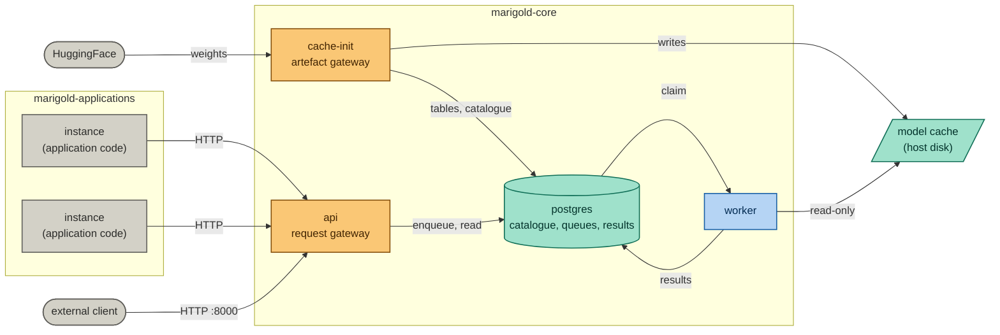
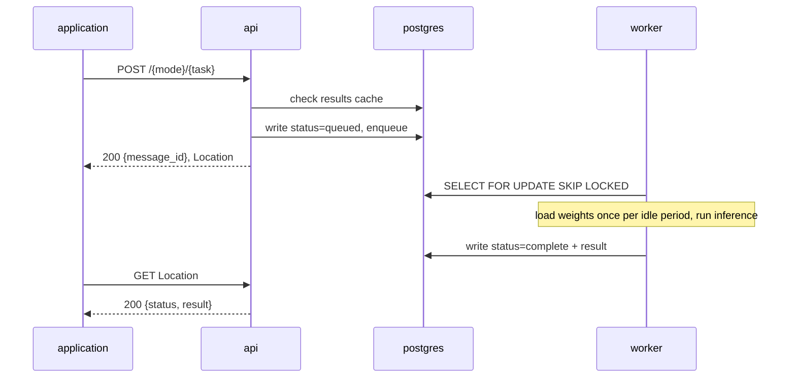

# Marigold

[](https://pypi.org/project/bayis-marigold/)
[](https://github.com/bayinfosys/marigold/tags)

A typed inference protocol over neural network models, self-hosted.
Typed operations -- a capability class, a model and an input set --
produce immutable results that applications compose.

Marigold runs as three separate layers on one host:

- **the platform** -- a model cache, a catalogue, a worker and an API,
  shared by everything on the host;
- **applications** -- a list of required models plus the code that uses
  them, installed into the cache by name;
- **instances** -- an application's code running in its own container,
  reaching the platform only through the API.

Applications hold no weights. Many instances share one model cache and
one worker, which is what lets a fleet of agents run on a single local
GPU and the same application run unchanged on larger hardware.

For a walkthrough, see the [setup tutorial](https://marigold.run/tutorials/setup.html).
The design is described in [ARCHITECTURE.md](docs/ARCHITECTURE.md),
[APPLICATIONS.md](docs/APPLICATIONS.md) and [PRINCIPLES.md](docs/PRINCIPLES.md).

## Status

Early stage. Interfaces, config format and the CLI may change without
notice. Issues and questions are welcome; for a pull request, open an
issue first to discuss the change before writing code.

## Prerequisites

- Docker and Docker Compose
- NVIDIA Container Toolkit, for a GPU worker
- Python 3.12, for the `marigold` command
- A HuggingFace token, for gated models

## Getting started

```bash
pip install bayis-marigold
git clone https://github.com/bayinfosys/marigold-examples

marigold cache init
marigold application create marigold-examples/platform-model-test -o /tmp
marigold application install /tmp/platform-model-test-0.2.0.tar.gz
marigold cache populate platform-model-test
marigold application start platform-model-test
marigold application logs platform-model-test
```

`cache init` creates the cache layout. `application create` builds an
archive from an application directory, and `application install` puts
it in the cache under its name. `cache populate` downloads the models
the application declares and registers them in the catalogue.
`application start` brings the platform up if it is not already
running, then starts the application in its own container.

```bash
marigold platform status                # platform and every application
marigold platform logs [service]        # api, worker, postgres, cache-init
marigold application stop <name>        # the application only
marigold platform stop --applications   # everything
marigold application list               # installed applications
marigold application uninstall <name>   # remove one; the cache is untouched
marigold cache inspect                  # what is cached, sizes, location
marigold config show [name]             # resolved configuration and its sources
```

`marigold app` is an alias for `marigold application`.

## Configuration

Two layers of TOML. The system config holds host settings:
`[platform]`, `[cache]` and `[database]`. Each application's
`marigold.toml` declares what the application is and runs:
`[application]`, `[execution]` and `[environment]`. An application
config that sets a host section is rejected. Where both layers set
`[environment]` values, the application's win per key.

The system config is `$MARIGOLD_CONFIG` if set, otherwise `config.toml`
in the current directory, otherwise `~/.marigold/config.toml`. Because
of the second rule, changing directory can change which config is used;
set `MARIGOLD_CONFIG` in scripts.

```toml
# config.toml -- the host
[platform]
compose_files = ["core", "cpu"]    # or ["core", "gpu"]
# tag = "0.7.0"                    # default: the installed CLI's version

[cache]
dir = "/data/marigold"             # default: ~/.marigold/cache

[database]
url = "postgresql://..."           # default: the platform's own Postgres
```

```toml
# marigold.toml -- an application
[application]
name = "chat"
version = "0.1.0"
models_yaml = ["models.yaml"]
compose_files = ["webui"]          # services added to the platform

[execution]
command = ["python", "main.py"]

[environment]
RAG_EMBEDDING_MODEL = "sentence-transformers/all-minilm-l6-v2"
```

`[application].name` and `version` are required to build or install an
archive. Running straight from a directory, the directory name stands in
for a missing name.

`[environment]` forwards variables to the containers without the CLI
interpreting them. `marigold config show <name>` prints every resolved
value and the layer it came from.

The full application format is in [APPLICATIONS.md](docs/APPLICATIONS.md).

## The model cache

```bash
marigold cache populate <name>    # download and register an application's models
marigold cache validate <name>    # check its models.yaml, no download
marigold cache inspect            # list what is on disk
```

The cache outlives every application. A model downloaded for one is
available to all; uninstalling an application removes nothing from the
cache or the catalogue. `populate --prune` removes cached models the
given application does not declare, and refuses when it declares none.

Model catalogue files are kept small and task-specific. An application
lists as many as it needs:

```toml
[application]
models_yaml = ["models-instruct.yaml", "models-embed.yaml"]
```

## Architecture



Two components face outward: the cache container brings artefacts in,
and the API lets requests in. The worker makes no outbound calls.
Postgres publishes no port on the host. Networks, mounts and the access
model are in [ARCHITECTURE.md](docs/ARCHITECTURE.md).

### Inference flow



Text and vector outputs are stored in Postgres. Binary outputs are
written under the cache's `data/outputs`.

## Model types

| Type | Input | Output | Example models |
|---|---|---|---|
| text-embedding | text | vector | all-minilm-l6-v2, bge-small-en-v1.5 |
| image-embedding | image | vector | clip-vit-base-patch32 |
| instruct | chat | chat | qwen3-0.6b, qwen2.5-3b-instruct |
| tts | text | audio (mp3) | mms-tts-eng, mms-tts-cym |
| txt2img | text | image (png) | stable-diffusion-3.5-large-turbo, flux.1-schnell |
| img2txt | image | text | smolvlm-256m-instruct, paligemma2 |
| depth | image | depth map (png) | dpt-dinov2-small-kitti |
| img2mask | image | segmentation mask (png) | sam-vit-huge |
| text-eval | text | scores | toxic-bert, distilbert-sst2 |
| text-similarity | text pair | similarity score | all-minilm-l6-v2 |
| image-eval | image | scores | nsfw-image-detection, cafe-aesthetic |
| image-text-eval | image + text | alignment score | clip-vit-base-patch32 |

## OpenAI-compatible endpoints

`GET /v1/models`, `POST /v1/chat/completions` and `POST /v1/embeddings`
wrap Marigold's submit and poll path for unmodified OpenAI-SDK clients
(open-webui, LangChain, LangGraph, Continue.dev and others).

- `stream=true` returns correctly framed SSE chunks, without
  token-level streaming.
- One tool call per assistant turn round-trips correctly. The wire
  format has no field for `tool_call_id`, so parallel tool calls cannot
  be matched back to the call that produced them.

## Repository structure

```
package/src/
  api/                  FastAPI application; routes/ is a package
  models/               model handlers, one file per model type
  shared/               enums, registry, database, outputs, usage
  cli/                  the `marigold` command
    main.py             parser
    commands.py         command implementations
    config.py           system and application TOML, with provenance
    paths.py            the cache layout
    archives.py         writing and extracting application archives
    applications.py     identity, installation, resolution
    compose.py          compose projects, environment, invocation
  compose/              compose files and the multi-stage Dockerfile
  tools/
    cache_cli.py        the cache container's entrypoint
    model_cache_shared.py  cache providers
```

Example applications live in [marigold-examples](https://github.com/bayinfosys/marigold-examples).

## Handler architecture

### Registry and decorator

Every model type is registered at import time with the `@model_spec`
decorator from `shared.registry`, which populates `_SPECS`, keyed by
`ModelType.value`. A `ModelSpec` couples the model type, the mode
(embed, eval, gen), the loader, the handler class implementing
`_run()`, the request and response models, the binary output fields,
and the API route.

### Loader contract

Every loader returns a `ModelLoaderResult`:

```python
@dataclass
class ModelLoaderResult:
    processor: Any   # tokenizer, image processor, or None
    model: Any       # the model, pipeline, or SentenceTransformer
```

`standard_loader` in `models/standard_loader.py` handles the common
`AutoTokenizer` / `AutoProcessor` plus `AutoModel` pattern.

### Handler contract

`BaseModelHandler.process()` validates the request against
`ModelSpec.request_model` and calls `_run()` with the typed result.
Subclasses implement only `_run()`.

### Adding a model

1. Add an entry to an application's `models.yaml`.
2. If the type is new, add a handler in `package/src/models/` following
   the existing pattern and register its import in `models/load_all()`.
3. `marigold cache validate <name>` to check the file.
4. Rebuild and reinstall the application, then `marigold cache populate <name>`.

## Authentication

Marigold has no authentication of its own. The caller is identified by
an optional `X-User-Id` header, defaulting to `local-user`, and that
header is trusted as received.

On localhost or a private network this needs nothing further. To expose
the API beyond that boundary, put the deployment's own authentication
in front of it -- a reverse proxy, a cloud load balancer, an identity
provider -- and have it set `X-User-Id` for each authenticated caller.
