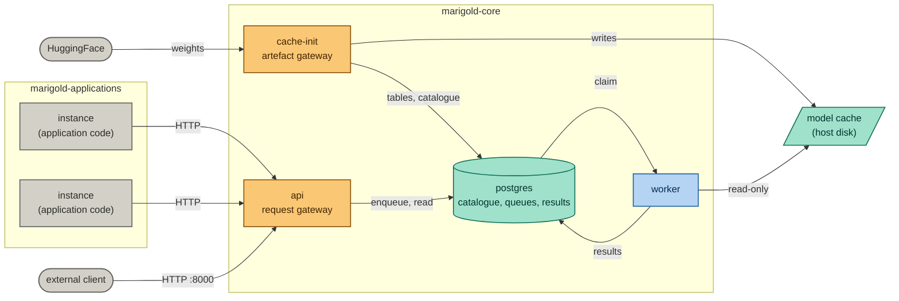
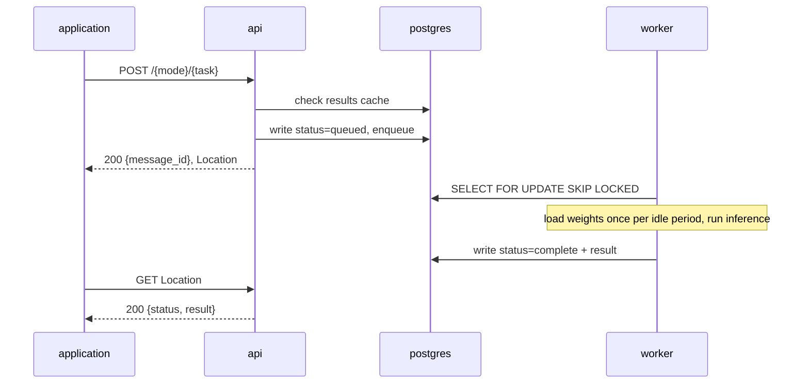

# Marigold -- Architecture

How the running system is divided, what each part may touch, and why.
The reasoning is in [PRINCIPLES.md](PRINCIPLES.md) (principles 6 and 7); this document
describes the result.

---

## Overview



---

## Three layers

**Platform.** Postgres, the API, the worker and the cache container.
One per host, shared by every application. Compose project `marigold`.
Configured entirely by `marigold-host.toml`, so it starts, stops and
reports with no application in hand:

    marigold platform start
    marigold platform status
    marigold platform logs [service]
    marigold platform stop

**Application.** A directory or archive holding `marigold.toml`, one or
more `models.yaml` files, and the code that uses them. Installed into
the cache under its name. See [Building](building.md).

**Instance.** An application's code running in its own container,
compose project `marigold-<application>`. Started, stopped and replaced
without touching the platform or any other application.

    marigold application start <name>
    marigold application status <name>
    marigold application logs <name>
    marigold application stop <name>

`application start` brings the platform up first when it is not already
running. Several applications share one platform; stopping one leaves
the others and the platform running. `platform stop` stops every
application first, then the platform: the platform's compose project
owns the `marigold-applications` network, and removing it beneath a
stopped instance leaves that instance unable to start.

---

## Code layers

The Python packages under `package/src` sit in four layers. A
component imports only from layers below its own, and components in
one layer import none of each other.

| Layer | Components |
|---|---|
| 3 entry points | cli, tools |
| 2 services | api, models |
| 1 adapters | backend |
| 0 core | shared |

- **core**: types, schemas, settings, the catalogue, and the queue and
  notification interfaces. It imports nothing from the other layers.
- **adapters**: the Postgres implementations of the core interfaces.
- **services**: the API and the worker with its handlers. They meet
  only through the queue and the tables, never through an import.
- **entry points**: the CLI, and cache-init, which loads handlers to
  download their models.

This table is the declaration the code is checked against:

    python scripts/layer_check.py

It reports each import against the layers and each cycle between
components, and exits 1 when it finds any.

---

## Two gateways

Two components face outward. Everything else is internal.

**The cache container** is the gateway for artefacts. It downloads
weights, reads installed applications, creates the platform's tables,
and writes the catalogue. It is the only component that needs outbound
network access, and the only one that writes the model cache.

**The API** is the gateway for requests. Applications and external
clients submit work, poll results, and read the catalogue through it.
It is the only component on both networks.

The worker talks to Postgres and reads the cache. It makes no outbound
calls: `HF_HUB_OFFLINE` is set, and the cache is mounted read-only.

Authentication is the deployment's concern. Marigold trusts the
`X-User-Id` header it receives; a proxy or load balancer in front of
the API authenticates callers and sets it.

---

## Networks

| Network | Members | Purpose |
|---|---|---|
| `marigold-core` | postgres, worker, cache-init, api | platform internals |
| `marigold-applications` | api, every instance | the only route from an application to the platform |

Postgres publishes no port on the host. Containers on `marigold-core`
reach it as `postgres:5432`; nothing else can. For a shell:

    docker compose -p marigold exec postgres psql -U marigold

The API publishes port 8000 on the host for external clients.

Both networks are created by the platform's compose file with fixed
names, and joined as external by the executor's, which is how two
compose projects share them.

---

## Mounts

| Host path (under the cache root) | cache-init | worker | api | instance |
|---|---|---|---|---|
| `data/models` | read-write | read-only | -- | -- |
| `data/applications` | read-only (`/applications`) | -- | -- | -- |
| `data/applications/_src/<digest>` | via the above | -- | -- | read-only (`/app`) |
| `data/applications/<name>/outputs` | -- | -- | -- | read-write (`/outputs`) |
| `data/outputs`, `data/tmp` | -- | read-write | -- | -- |
| `data/postgres` | -- | -- | -- | -- (postgres only) |

The CLI, on the host, writes under `data/applications`: the installed
index (`installed.json`), the archives (`_archives/`) and the extracted
trees (`_src/`). `marigold cache init` creates the layout with the
invoking user's ownership; directories Docker creates for a bind mount
are owned by root.

In `s3` mode the worker and the API reach the object store by endpoint
instead, and `data/outputs` is unused. The access design is the same
as the database's: the worker writes, the API reads.

---

## Data directories

Every piece of state lives under the cache root's `data/`. Delete a
directory only with the platform stopped (`marigold platform stop`).

| Directory | Holds | Deleting it |
|---|---|---|
| `data/postgres` | the platform database: the catalogue and failure marks, queues, results, usage, worker environments, lifecycle events | loses queued requests, results, usage and event history. The next start creates empty tables, and `cache populate` re-registers each application's models without downloading them |
| `data/models` | downloaded weights, shared by every application | removes every model. Catalogue rows remain and their loads fail; `cache populate` downloads each application's models again |
| `data/applications` | the installed index (`installed.json`), archives (`_archives/`), extracted trees (`_src/`) and each application's `outputs/` | uninstalls every application and removes its outputs. Cached models and catalogue rows remain; reinstall each application |
| `data/webui` | Open WebUI's own database: chats, users, settings | resets Open WebUI to a first start |
| `data/outputs` | binary inference outputs | breaks `GET /output/.../{field}` for every completed job that wrote one |
| `data/tmp` | worker offload space | nothing a stopped worker needs |

`data/postgres` and `data/webui` belong to the users those containers
run as, so deleting them takes `sudo`.

### Resetting the database

Clearing the database keeps every downloaded weight:

```sh
marigold platform stop
sudo rm -rf <cache root>/data/postgres
marigold platform start
marigold cache populate <application>     # for each installed application
```

`platform start` creates a fresh database and its tables. `cache
populate` finds each model already in the cache, downloads nothing,
and writes its catalogue row and queue.

---

## Access model

Each component owns what it writes. The table is the design; roles and
per-component DSNs are not yet enforced, so today every component
connects as the same Postgres user.

| Table | cache-init | worker | api |
|---|---|---|---|
| catalogue | write | read | read |
| queue tables | create | read, update, delete | insert, read |
| results, usage | create | write | read |
| workers | create | write | -- |
| events | create | write | write, read |

Table creation belongs to the cache container, which runs before
anything is served on every platform start. The worker still creates
four tables of its own at startup; that is the one remaining
exception, recorded in TODO.md.

Model failure state (`failed_reason`) is written by the worker onto the
catalogue row today. Under enforced roles it moves to a table the
worker owns, so the catalogue stays a record of cache contents.

---

## Inference flow



Text and vector outputs are stored in Postgres. Binary outputs are
written under the cache's `data/outputs`.

---

## Lifecycle events

The API and the worker publish an event at each change of state, and
each is stored as a row in the `events` table, keyed by model
(`WORKER#<model hash>`) and sorted by timestamp, then event type
(`EVENT#<timestamp>#<event type>`). A model's history survives
restarts and log rotation. Rows have no TTL and accumulate.

| Event | Published by | When |
|---|---|---|
| `REQUEST_QUEUED` | api | a submission is queued |
| `MODEL_LOADING` | worker | a load starts |
| `MODEL_LOADED` | worker | the model is resident and fits |
| `MODEL_LOAD_FAILED` | worker | the load failed |
| `WORKER_STARTED` | worker | the model's queue starts draining |
| `REQUEST_DEQUEUED`, `REQUEST_PROCESSING` | worker | a message is claimed, then run |
| `REQUEST_COMPLETE`, `REQUEST_ERROR` | worker | a request ends |
| `WORKER_IDLE` | worker | the queue empties, once per idle period |
| `WORKER_EXITING` | worker | the model is released |

Every worker event carries `model_name`, `model_type`, `model_hash`,
`worker_id` and `hostname`; request events carry the `message_id` and
`user_id`, and `REQUEST_ERROR` the error. The load events carry what a
load decided:

| Field | `MODEL_LOADED` | `MODEL_LOAD_FAILED` |
|---|---|---|
| `settings` | each resolved setting, `{"value", "source"}` | as far as the load reached |
| `footprint_bytes` | the weights' memory footprint | as far as the load reached |
| `dtype` | the model's dtype | as far as the load reached |
| `placement` | bytes on each device, such as `{"cuda:0": ..., "cuda:1": ...}`; `{"cpu": footprint}` on a worker with no CUDA device | -- |
| `cpu_offload_bytes` | bytes off the GPU, also recorded with each request's usage | -- |
| `free_vram_b`, `total_vram_b`, `usable_vram_b` | VRAM across devices after the load | -- |
| `error` | -- | the message recorded as `failed_reason` |

---

## The catalogue

A catalogue row means a model's weights are in the cache. `marigold
cache populate <name>` reads the application's models.yaml inside the
cache container, downloads what is missing, and registers each model as
its weights are confirmed: queue first, then row. A model that fails to
download gets no row.

The catalogue is host-wide. Rows accumulate across applications and are
never removed by uninstalling one: a cached model stays available to
every application.

The API answers accordingly:

| Response | Meaning |
|---|---|
| 400 unknown model | not in the catalogue: not cached, or never declared |
| 409 model load failed | cached, but the worker could not load it |
| 503 | platform tables not yet created |

---

## Failure containment

A model that fails to download is reported by `cache populate` and gets
no row; every other model proceeds. A model that fails to load is
marked by the worker, its queue drained with errors, and further
submissions rejected with 409; the worker moves on. An application that
fails exits in its own container; the platform and other applications
are unaffected. An application whose platform stops keeps running and
fails its API calls, visibly, in its own logs.

### Model load failure

The worker applies the model's settings, loads it and checks that its
weights fit in VRAM. Failure at any of these steps:

- publishes `MODEL_LOAD_FAILED` with the error message;
- writes an error result, code `model_load_failed`, for every message
  queued for the model, and deletes the messages;
- records the error as `failed_reason` on the model's catalogue row.

The message gives the reason: an exception from the loader, or for a
model that does not fit, the tensors left off the GPU and the free and
total memory of each device.

While `failed_reason` is set, the API answers a submission for the
model with 409 and the reason as `message`, writing no result and
queueing nothing; `POST /v1/chat/completions` returns the same 409.
The worker drains anything that reaches the model's queue by another route.

`marigold cache populate <application>` writes each model's row afresh
from models.yaml, which clears `failed_reason`, and the next request
loads the model again. A request that ended in an error is not served
from the results cache: repeating it submits it again.

---

## Scaling

The worker serves one model at a time, choosing the deepest queue on
each sweep. Several applications sharing one worker queue behind one
another, which is how a fleet of agents runs on a single local GPU.
Queue claims use `SELECT ... FOR UPDATE SKIP LOCKED`, so adding workers
is safe at the message level; assigning models to specific workers is
future work, recorded in TODO.md.

---

## Known gaps

- Postgres roles per component are designed and not enforced.
- The worker still creates its own tables at startup.
- `marigold-core` has a route out; making it internal needs the cache
  container on a separate egress network.
- Application archives are extracted with `filter="data"` and no limit
  on uncompressed size or member count.
- The installed index is written by the CLI on the host, outside any
  container's ownership.
- `marigold-host.toml` is found relative to the working directory
  before the home directory, so changing directory can change which
  cache and platform the CLI addresses. `--host-config` or
  `MARIGOLD_HOST_CONFIG` fixes it.
